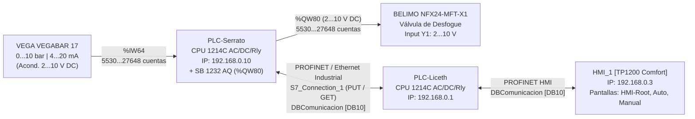
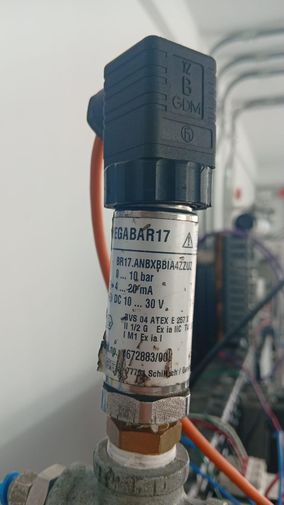
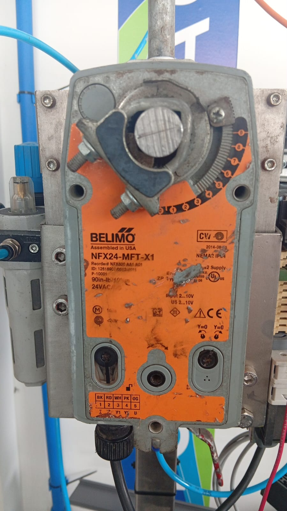
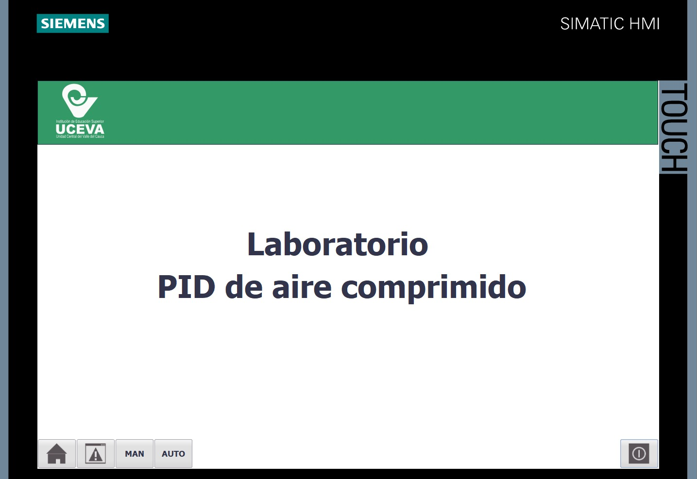
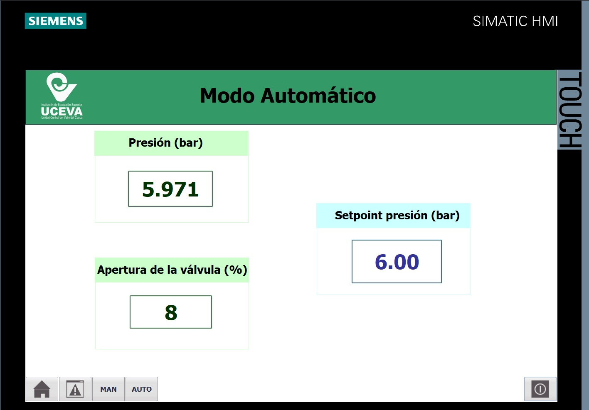
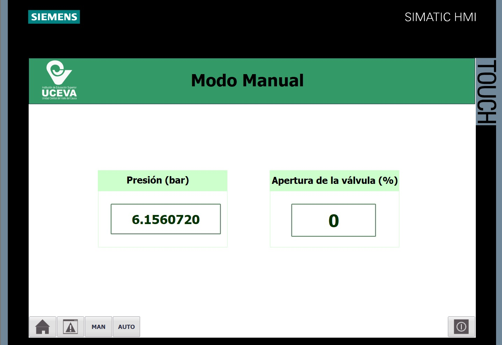
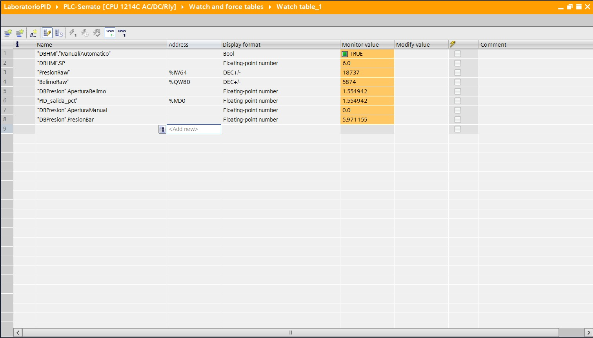
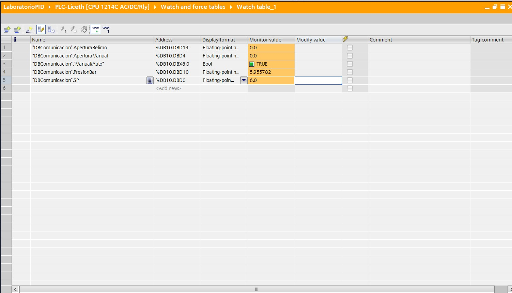

# Control PID de Presión Neumática y Comunicación Industrial PROFINET (TIA Portal V21 — Siemens S7-1200)

<p align="center">
  
  
  
  
  
  
  
  
</p>

> **Topics (Etiquetas):** `siemens` · `s7-1200` · `tia-portal` · `profinet` · `pid-control` · `industrial-automation` · `plc` · `hmi` · `vega` · `belimo` · `control-systems` · `uceva`

---

## 1. Encabezado e Información Académica

| Campo | Información Auditada |
| :--- | :--- |
| **Institución** | Unidad Central del Valle del Cauca (UCEVA) — Programa de Ingeniería Electrónica (Semestre IX) |
| **Asignatura** | Electiva en Ingeniería III (Código: `20162`) |
| **Práctica N.° 1** | Variables análogas y comunicación industrial |
| **Docente** | Manuel Restrepo |
| **Integrantes** | Liceth Bolaños, Juan Serrato, Alejandro Gonzalez, Samuel Guevara |
| **Ambiente de Aprendizaje** | Laboratorio de Automatización (UCEVA) |
| **Formato de Referencia** | [Guía de laboratorio.pdf](./Guía%20de%20laboratorio.pdf) (`GFO-GCUR-F-048`, Vers. 1) |

---

## 2. Descripción y Objetivos del Proyecto

Este repositorio contiene el proyecto completo de automatización industrial desarrollado en **TIA Portal V21** (`LaboratorioPID.ap21`), junto con su guía de práctica, tablas de observación en línea (*Watch Tables*), pantallas de interfaz HMI y evidencia fotográfica de la instrumentación de campo.

El sistema implementa un **lazo cerrado de control continuo de presión de aire comprimido** basado en una arquitectura distribuida con **dos autómatas Siemens SIMATIC S7-1200 (CPU 1214C AC/DC/Rly)** interconectados en una red **PROFINET / Ethernet Industrial**:
- El controlador de campo y lazo PID (**`PLC-Serrato`**, IP `192.168.0.10`) adquiere la variable de proceso (*PV*) desde un transmisor de presión **VEGA VEGABAR 17** (`0 ... 10 bar`, `4 ... 20 mA` acondicionado a `2 ... 10 V DC`), ejecuta el algoritmo de regulación mediante el bloque tecnológico **`PID_Compact`** con acción inversa en interrupción cíclica (`OB_CyclicInterrupt` / `OB30`), gestiona la conmutación entre operación **Manual / Automático** y comanda un actuador eléctrico modulante **BELIMO NFX24-MFT-X1** (`2 ... 10 V DC`) mediante una tarjeta de señal frontal (**SB 1232 AQ 1x12Bit**).
- El segundo controlador (**`PLC-Liceth`**, IP `192.168.0.1`) actúa como nodo de enlace HMI y socio de comunicación S7 sobre PROFINET (`S7_Connection_1`), empleando los bloques **`PUT`** (`PUT_DB [DB4]`) y **`GET`** (`GET_DB [DB5]`) para intercambiar consignas, modo de operación y telemetría de proceso con `PLC-Serrato` a través del bloque de datos compartido **`DBComunicacion [DB10]`**.
- La supervisión y operación local se realiza desde una pantalla **SIMATIC HMI TP1200 Comfort** (`WinCC Comfort V21`, IP `192.168.0.3`), conectada directamente vía PROFINET a **`PLC-Liceth` (`192.168.0.1`)**.

### Objetivos según la Guía de Laboratorio

- **Objetivo General:**
  > Instalar, conectar y programar una arquitectura de comunicación entre PLCs que permita adquirir, convertir, enviar y recibir datos análogos de procesos continuos mediante controlador PID.

- **Objetivos Específicos:**
  - Programar entradas y salidas análogas en el PLC.
  - Programar rutina continua mediante controlador PID.
  - Configurar comunicación PROFINET para enviar y recibir datos análogos del proceso continuo.

---

## 3. Arquitectura de Hardware y Red PROFINET

La auditoría cruzada entre el archivo del proyecto (`System/PEData.plf`), las compilaciones de HMI (`IM/HMI/C/1/Generates/DownloadTask.xml`) y las capturas de TIA Portal en línea confirma la siguiente composición de hardware y red:

### 3.1 Estaciones y Módulos Configurados

| Estación en TIA Portal | Equipo / Modelo | Referencia (MLFB) | Firmware / Versión | Especificaciones Técnicas Principales | Dirección IP / Rol |
| :--- | :--- | :--- | :--- | :--- | :--- |
| **`PLC-Serrato`**<br>*(S7-1200 station_1)* | **Siemens SIMATIC S7-1200**<br>CPU 1214C AC/DC/Rly | `6ES7 214-1BG40-0XB0` | `V4.2` | • Memoria de trabajo: `100 KB`<br>• Alimentación: `120 / 240 V AC`<br>• Entradas digitales: `14 DI 24 V DC`<br>• Salidas digitales: `10 DQ a relé`<br>• Entradas analógicas integradas: `2 AI` (`0–10 V DC`, `%IW64`–`%IW66`)<br>• Interfaz `PROFINET IO` integrada | **`192.168.0.10`**<br>Controlador de campo, adquisición y lazo `PID_Compact` (`PLCPID`) |
| **`AQ 1x12Bit_1`**<br>*(Acoplado en `PLC-Serrato`)* | **Signal Board SB 1232 AQ**<br>1 salida analógica (12 bits) | `6ES7 232-4HA30-0XB0` | `V1.0` | • Añade `1 AQ` (`±10 V` / `0–20 mA`, `12 bits`) sobre la CPU 1214C (que no cuenta con AQ integradas)<br>• Configurada en tensión hacia actuador en **`%QW80`** | Canal de mando analógico `2 ... 10 V DC` (`"BelimoRaw"`) |
| **`PLC-Liceth`**<br>*(S7-1200 station_2)* | **Siemens SIMATIC S7-1200**<br>CPU 1214C AC/DC/Rly | `6ES7 214-1BG40-0XB0` | `V4.2` | • Memoria de trabajo: `100 KB`<br>• `14 DI 24 V DC` / `10 DQ a relé`<br>• `2 AI integradas`<br>• Interfaz `PROFINET IO` integrada | **`192.168.0.1`**<br>Enlace directo a HMI y comunicación S7 `PUT` / `GET` (`PLCHMI`) |
| **`HMI_1`**<br>*(WinCC Comfort)* | **Siemens SIMATIC HMI**<br>TP1200 Comfort | `6AV2 124-0MC01-0AX0` | Imagen `17.0.0.0`<br>(`WinCC V21`) | • Pantalla táctil widescreen de `12"`<br>• Runtime `COLORADO / RT 17.0.0.0` | **`192.168.0.3`**<br>Enlazada a `PLC-Liceth` (`192.168.0.1`) — Supervisión y mando (Auto / Manual) |

### 3.2 Topología de Red e Intercambio de Variables PROFINET



#### Mapa de Memoria Compartida — `DBComunicacion [DB10]` (Acceso Estándar / No Optimizado)

El bloque de datos **`DBComunicacion [DB10]`** tiene una longitud total configurada de **18 bytes (`144 bits`)** con direccionamiento absoluto habilitado para permitir operaciones S7 `PUT`/`GET` entre ambos PLCs:

| Variable en `DBComunicacion` | Dirección Absoluta | Tipo de Dato | Dirección de Flujo S7 | Descripción Funcional |
| :--- | :--- | :--- | :--- | :--- |
| `"DBComunicacion".SP` | `%DB10.DBD0` | `Real` | Consigna (`PLC-Liceth` ↔ `PLC-Serrato`) | *Setpoint* de presión deseado en bares (`bar`) |
| `"DBComunicacion".AperturaManual` | `%DB10.DBD4` | `Real` | Comando (`PLC-Liceth` ↔ `PLC-Serrato`) | Porcentaje de apertura manual (`0.0 ... 100.0 %`) |
| `"DBComunicacion"."Manual/Auto"` | `%DB10.DBX8.0` | `Bool` | Selector (`PLC-Liceth` ↔ `PLC-Serrato`) | Selector de modo (`FALSE` = Manual, `TRUE` = Automático) |
| `"DBComunicacion".PresionBar` | `%DB10.DBD10` | `Real` | Telemetría (`PLC-Serrato` → `PLC-Liceth`) | Presión medida escalada en unidades de ingeniería (`bar`) |
| `"DBComunicacion".AperturaBelimo` | `%DB10.DBD14` | `Real` | Telemetría (`PLC-Serrato` → `PLC-Liceth`) | Porcentaje efectivo enviado al actuador (`0.0 ... 100.0 %`) |

---

## 4. Instrumentación de Campo (Sensor y Actuador)

Toda la información técnica de la instrumentación fue verificada directamente sobre las placas de características, etiquetas y cableado real de los equipos del laboratorio.

### 4.1 Transmisor de Presión — VEGA VEGABAR 17

<p align="center">
  
</p>

| Parámetro Auditado | Especificación Verificada en Equipo (`Vegabar.jpeg`) |
| :--- | :--- |
| **Fabricante** | VEGA Grieshaber KG (`77761 Schiltach / Germany`) |
| **Modelo / Serie** | `VEGABAR 17` (`VEGABAR17`) |
| **Código de Configuración** | `BR17.ANBXBBIA4ZZUZ` |
| **Número de Serie (`ord. no.`)** | `1672883/00` |
| **Rango de Medición** | `0 ... 10 bar` |
| **Señal de Salida** | `4 ... 20 mA` (lazo de corriente a 2 hilos) |
| **Tensión de Alimentación** | `10 ... 30 V DC` |
| **Certificación ATEX (Seguridad Intrínseca)** | `BVS 04 ATEX E 257 X` \| `II 1/2 G Ex ia IIC T4` \| `I M1 Ex ia I` |
| **Montaje Mecánico** | Rosca metálica en cuerpo inoxidable con hexágono de ajuste, **adaptador hexagonal de bronce** y sellado con **cinta de teflón (PTFE)** sobre racor de tubería galvanizada de la línea neumática |
| **Conector Eléctrico** | Conector industrial enchufable **DIN 43650 Forma A** color negro (**Hirschmann `12 B GDM`**) con prensaestopas y cable de instrumentación color naranja |
| **Acondicionamiento al S7-1200** | Conversión de lazo `4 ... 20 mA` a tensión `2 ... 10 V DC` sobre la entrada analógica integrada de la CPU 1214C (`%IW64`, rango digital `5530 ... 27648`) |

---

### 4.2 Actuador Eléctrico con Retorno por Resorte — BELIMO NFX24-MFT-X1

<p align="center">
  
</p>

| Parámetro Auditado | Especificación Verificada en Equipo (`Belimo.jpeg`) |
| :--- | :--- |
| **Fabricante** | Belimo (*Assembled in USA*) |
| **Modelo** | `NFX24-MFT-X1` |
| **Código de Reorden (`Reorder#`)** | `NFX500 AA1 A01` |
| **Identificación / Lote / Fecha** | `ID: 12616907/0012/4011` \| `P-10001` \| Fecha en placa: `2014-08-29` |
| **Par Nominal y Falla Segura** | `90 in-lb (10 Nm)` \| ***Spring Return*** (retorno mecánico por resorte en `< 20 s` ante pérdida de alimentación; tiempo de giro con motor `150 s`) |
| **Características Mecánicas** | Escala angular visual graduada de **`0` a `9`** en el frente naranja, selector de sentido de giro `CW / CCW` (`Y=0`), abrazadera metálica dentada superior acoplada al vástago; ubicado junto a unidad neumática azul (filtro-regulador y tubería de poliuretano) |
| **Alimentación Eléctrica** | `24 V AC/DC` (*Class 2 Supply*) |
| **Grado de Protección y Normas** | `NEMA 2 / IP54` \| `cULus LISTED` / `CE` |
| **Señal de Control y Realimentación (MFT)** | • Entrada de mando analógica: **`Input 2 ... 10 V`** (`Y1`)<br>• Señal de realimentación de posición: **`U5 2 ... 10 V`** (`U`) |

#### Código de Cableado Grabado en la Placa Frontal del Actuador

| Borne / Pin | Color del Conductor | Símbolo en Placa | Función Eléctrica |
| :---: | :---: | :---: | :--- |
| **`1`** | `BK` (Negro) | `⊥` | Común / Tierra de referencia (`GND`) |
| **`2`** | `RD` (Rojo) | `~ +` | Alimentación `24 V AC/DC` |
| **`3`** | `WH` (Blanco) | `Y1` | Entrada de control proporcional `2 ... 10 V DC` (desde `%QW80` de `SB 1232 AQ`) |
| **`4`** | `PK` (Rosa) | `Y2` | Entrada auxiliar de control |
| **`5`** | `OG` (Naranja) | `U` | Salida de realimentación analógica `U5` (`2 ... 10 V DC`) |

---

## 5. Lógica de Control en TIA Portal

El programa en TIA Portal V21 distribuye la ejecución entre ambos controladores mediante bloques de organización (OB), funciones (FC) y bloques de datos globales e instancia (DB):

### 5.1 Organización de Bloques de Programa

- **En `PLC-Serrato` (`192.168.0.10`) — Adquisición, Escalamiento y Lazo PID:**
  - `Main [OB1]`: Ciclo principal con segmentos dedicados para *Bloque de sensor de presión* (`Vegabar_NS [FC1]`) y *Bloque de actuador válvula* (`Belimo_NS [FC2]`).
  - `OB_CyclicInterrupt [OB30]`: Interrupción cíclica de tiempo fijo donde se ejecuta el *Bloque PID* (**`PID_Presión [DB3]`**, instancia de `PID_Compact`) y el segmento *Habilitación de modo manual*, encargado de seleccionar entre la salida automática `"PID_salida_pct"` (`%MD0`) y la consigna `"DBPresion".AperturaManual` según el estado de `"DBHMI"."Manual/Automatico"` (`TRUE` = Automático, `FALSE` = Manual).
  - `Vegabar_NS [FC1]`: *Normalización y escalamiento de sensor* (`%IW64` → `"DBPresion".PresionBar`).
  - `Belimo_NS [FC2]`: *Normalización y escalamiento de actuador* (`"DBPresion".AperturaBelimo` → `%QW80`).
  - Bloques de datos locales: `DBPresion [DB1]`, `DBHMI [DB2]`, `PID_Presión [DB3]`.

- **En `PLC-Liceth` (`192.168.0.1`) — Enlace HMI (`192.168.0.3`) y Comunicación PROFINET S7:**
  - `Main [OB1]` (*Bloque de comunicación*) y `Comunicacion [FC1]`: Ejecutan los bloques de comunicación S7 **`PUT`** (instancia `PUT_DB [DB4]`, *Bloque PUT*) y **`GET`** (instancia `GET_DB [DB5]`, *Bloque GET*) sobre el enlace configurado `S7_Connection_1` con disparo cíclico mediante marca de reloj (`Clock_2Hz`), sincronizando las *Variables enviadas* (consignas y modo recibidos desde la **`HMI_1`** en `192.168.0.3`) y las *Variables recibidas* (presión y apertura procedentes de **`PLC-Serrato`** en `192.168.0.10`) en **`DBComunicacion [DB10]`**.

---

### 5.2 Escalamiento `2–10 V` (`5530` – `27648` cuentas) con `NORM_X` y `SCALE_X`

En los módulos analógicos Siemens S7-1200 de rango nominal `0 ... 10 V DC`, la representación entera de escala completa abarca de **`0` a `27648` cuentas**. Debido a que tanto el transmisor **VEGABAR 17** (`4 ... 20 mA` convertido a `2 ... 10 V DC`) como el actuador **BELIMO NFX24-MFT-X1** (`Input 2 ... 10 V DC`) operan con **cero vivo en `2 V DC`**, el umbral inferior se calcula como:

$$\text{Cuentas}_{\min\,(2\,\text{V})} = \frac{2\,\text{V}}{10\,\text{V}} \times 27648 = 5529.6 \approx \mathbf{5530}$$

#### A. Adquisición del Sensor (`Vegabar_NS [FC1]`)
1. **`NORM_X` (`Int` → `Real`)**: Normaliza la palabra cruda `"PresionRaw"` (`%IW64`) con límite inferior `MIN = 5530` y límite superior `MAX = 27648` hacia una fracción normalizada en `[0.0, 1.0]`.
2. **`SCALE_X` (`Real` → `Real`)**: Escala dicha fracción normalizada entre `MIN = 0.0` y `MAX = 10.0 bar`, almacenando el resultado en **`"DBPresion".PresionBar`**.

> **Verificación Auditada contra `WatchTable PLCPID.jpeg`:** con una lectura cruda medida de `"PresionRaw" = 18737` cuentas en `%IW64`, el cálculo coincide exactamente al sexto decimal con el valor monitoreado en línea (`5.971155`):

$$\text{Norm} = \frac{18737 - 5530}{27648 - 5530} = \frac{13207}{22118} \approx 0.59711547 \quad \Longrightarrow \quad \text{PresionBar} = 0.59711547 \times 10.0 = \mathbf{5.971155\,\text{bar}}$$

#### B. Comando al Actuador (`Belimo_NS [FC2]`) — Eliminación de Zona Muerta (`0–1.9 V`)
El actuador **BELIMO NFX24-MFT-X1** presenta una **zona muerta entre `0 V` y `1.9 V DC`** donde ignora la señal de entrada y permanece completamente en su posición base (`0 %`). Si se escalara desde `0` a `27648`, el controlador desperdiciaría casi el `20 %` de su rango de salida antes de que el motor comenzara a mover la válvula, degradando la respuesta transitoria del PID.
Para evitarlo:
1. **`NORM_X` (`Real` → `Real`)**: Normaliza `"DBPresion".AperturaBelimo` de `MIN = 0.0 %` a `MAX = 100.0 %` al intervalo `[0.0, 1.0]`.
2. **`SCALE_X` (`Real` → `Int`)**: Escala `[0.0, 1.0]` entre **`MIN = 5530`** (`2.0 V DC`) y **`MAX = 27648`** (`10.0 V DC`), escribiendo directamente sobre **`"BelimoRaw"` (`%QW80`)** en la tarjeta `SB 1232 AQ`.

> **Verificación Auditada contra `WatchTable PLCPID.jpeg`:** con una apertura comandada de `"DBPresion".AperturaBelimo = 1.554942 %`, el cálculo coincide exactamente con el valor digital entero observado en `%QW80` (`5874`):

$$\text{BelimoRaw} = 5530 + \left(\frac{1.554942}{100.0}\right) \times (27648 - 5530) = 5530 + 343.92 = 5873.92 \approx \mathbf{5874}$$

---

### 5.3 Acción Inversa del Controlador `PID_Compact`

En la planta de aire comprimido del laboratorio, la válvula accionada por el **BELIMO NFX24-MFT-X1** funciona como **válvula de desfogue / alivio** respecto a la línea presurizada que mide el transmisor **VEGA VEGABAR 17**:
- Al **abrir** la válvula (`AperturaBelimo` ↑), el aire escapa y la presión de la línea **disminuye**.
- Al **cerrar** la válvula (`AperturaBelimo` → `0 %`), el aire suministrado se retiene y la presión de la línea **aumenta**.

Por esta dinámica inversa de la planta, en el bloque **`PID_Presión [DB3]` (`PID_Compact`)** se configuró **sentido de regulación invertido** (*Invertir sentido de regulación* = **`TRUE`**, verificado en los parámetros internos de instancia de `PID_Presión`):
- Si la presión medida supera la consigna ($PV > SP$), el controlador **incrementa** su porcentaje de salida (`PID_salida_pct` ↑) para abrir la válvula Belimo y desfogar presión hasta estabilizarla en el *Setpoint*.
- Si la presión medida cae por debajo de la consigna ($PV < SP$), el controlador **reduce** su salida hacia `0 %` para cerrar el desfogue y permitir que la línea recupere presión hacia el *Setpoint*.

---

## 6. Interfaz Hombre-Máquina (HMI) y Tablas de Observación

La supervisión y validación experimental del sistema quedó registrada tanto en las pantallas de la HMI (`TP1200 Comfort`) como en las tablas de observación (*Watch Tables*) de TIA Portal para ambos PLCs.

### 6.1 Pantallas de Operación HMI (`WinCC Comfort V21` — IP `192.168.0.3` → `PLC-Liceth`)

| Pantalla Raíz (`HMI-Root`) | Modo Automático | Modo Manual |
| :---: | :---: | :---: |
|  |  |  |

1. **Pantalla de Inicio ([`images/HMI-Root.jpeg`](./images/HMI-Root.jpeg))**: Presenta el encabezado institucional UCEVA, el título del sistema (**"Laboratorio PID de aire comprimido"**) y la barra inferior de navegación global: botón *Home*, diagnóstico de alarmas, selector de pantalla **`MAN`**, selector **`AUTO`** y botón de salida del *Runtime*.
2. **Pantalla Modo Automático ([`images/HMI-Auto.jpeg`](./images/HMI-Auto.jpeg))**: Despliega en tiempo real la presión del proceso (`Presión (bar): 5.971`), el campo editable de referencia (`Setpoint presión (bar): 6.00`) y el porcentaje de apertura calculado por el lazo PID (`Apertura de la válvula (%): 8`).
3. **Pantalla Modo Manual ([`images/HMI-Manual.jpeg`](./images/HMI-Manual.jpeg))**: Permite monitorear la presión actual (`Presión (bar): 6.1560720`) e imponer directamente una consigna de apertura manual al actuador (`Apertura de la válvula (%): 0`), inhabilitando la acción automática del `PID_Compact`.

---

### 6.2 Tablas de Observación en Línea (*Watch Tables*)

#### A. PLC Controlador PID — `PLC-Serrato (192.168.0.10)` `[CPU 1214C AC/DC/Rly]`

<p align="center">
  
</p>

| # | Variable en `PLC-Serrato` | Dirección | Formato | Valor Monitoreado | Interpretación Técnica |
| :---: | :--- | :---: | :---: | :---: | :--- |
| 1 | `"DBHMI"."Manual/Automatico"` | — | `Bool` | `TRUE` | Lazo en **Modo Automático** (`PID_Compact` activo) |
| 2 | `"DBHMI".SP` | — | `Real` | `6.0` | *Setpoint* fijado en **`6.0 bar`** |
| 3 | `"PresionRaw"` | `%IW64` | `DEC+/-` | `18737` | Cuentas ADC de la AI integrada (equivalente a ~`6.78 V` en lazo `2–10 V`) |
| 4 | `"BelimoRaw"` | `%QW80` | `DEC+/-` | `5874` | Cuentas DAC enviadas por `SB 1232 AQ` (`≈ 2.12 V` al actuador Belimo) |
| 5 | `"DBPresion".AperturaBelimo` | — | `Real` | `1.554942` | Porcentaje final comandado a la válvula (`1.55 %`) |
| 6 | `"PID_salida_pct"` | `%MD0` | `Real` | `1.554942` | Salida calculada directamente por `PID_Presión [DB3]` |
| 7 | `"DBPresion".AperturaManual` | — | `Real` | `0.0` | Consigna de modo manual en reposo (`0.0 %`) |
| 8 | `"DBPresion".PresionBar` | — | `Real` | `5.971155` | Variable de proceso estabilizada en **`5.97 bar`** cerca del `SP = 6.0 bar` |

#### B. PLC de Interfaz HMI y Comunicación PROFINET — `PLC-Liceth (192.168.0.1)` `[CPU 1214C AC/DC/Rly]`

<p align="center">
  
</p>

| # | Variable en `DBComunicacion` | Dirección | Formato | Valor Monitoreado | Rol en Comunicación PROFINET (`PUT`/`GET`) |
| :---: | :--- | :---: | :---: | :---: | :--- |
| 1 | `"DBComunicacion".AperturaBelimo` | `%DB10.DBD14` | `Real` | `0.0` | Apertura efectiva de válvula recibida/sincronizada desde el proceso |
| 2 | `"DBComunicacion".AperturaManual` | `%DB10.DBD4` | `Real` | `0.0` | Consigna de apertura manual intercambiada |
| 3 | `"DBComunicacion"."Manual/Auto"` | `%DB10.DBX8.0` | `Bool` | `TRUE` | Estado de selector Automático (`TRUE`) / Manual (`FALSE`) |
| 4 | `"DBComunicacion".PresionBar` | `%DB10.DBD10` | `Real` | `5.955782` | Lectura de presión en línea transferida vía red (`5.96 bar`) |
| 5 | `"DBComunicacion".SP` | `%DB10.DBD0` | `Real` | `6.0` | Consigna de presión compartida (`6.0 bar`) |

---

## 7. Estructura del Repositorio y Software Requerido

### 7.1 Entorno de Software Validado (`ProjectInfo.txt`)

| Producto / Paquete Siemens | Versión | Versión Técnica |
| :--- | :---: | :---: |
| **Totally Integrated Automation Portal (TIA Portal)** | `V21` | `21.00.00.00` |
| **STEP 7 Basic** | `V21` | `21.00.00.00` |
| **WinCC Comfort** | `V21` | `21.00.00.00` |
| **HSP PID Control** | `V14` | `14.00.00.00` |

### 7.2 Árbol Completo de Archivos del Proyecto

```text
LaboratorioPID/
├── LaboratorioPID.ap21            # Archivo principal del proyecto en TIA Portal V21
├── LaboratorioPID.info            # Metadatos de última edición del proyecto
├── ProjectInfo.txt                # Inventario oficial de productos y versiones TIA Portal
├── Guía de laboratorio.pdf        # Guía académica oficial UCEVA (GFO-GCUR-F-048)
├── README.md                      # Documentación técnica y de auditoría del proyecto
├── images/                        # Carpeta dedicada con todas las imágenes de evidencia y HMI
│   ├── Vegabar.jpeg               # Fotografía placa y montaje transmisor VEGA VEGABAR 17
│   ├── Belimo.jpeg                # Fotografía placa y cableado actuador BELIMO NFX24-MFT-X1
│   ├── HMI-Root.jpeg              # Pantalla principal HMI TP1200 Comfort
│   ├── HMI-Auto.jpeg              # Pantalla HMI Modo Automático
│   ├── HMI-Manual.jpeg            # Pantalla HMI Modo Manual
│   ├── WatchTable-PLCPID.jpeg     # Watch Table en línea de PLC-Serrato (lazo PID)
│   └── WatchTable-PLCHMI.jpeg     # Watch Table en línea de PLC-Liceth (enlace HMI / DB10)
├── AdditionalFiles/               # Archivos adicionales de configuración (PLCM)
│   └── PLCM/
├── IM/                            # Datos intermedios compilados de HMI, índices y opciones
│   ├── HMI/
│   ├── SearchIndex/
│   └── SPL/
├── Logs/                          # Directorio de compilación/diagnóstico (localmente vacío en TIA Portal)
├── System/                        # Base de datos interna del proyecto TIA Portal (PEData.*)
├── TMP/                           # Directorio temporal (localmente vacío en TIA Portal)
├── UserFiles/                     # Archivos auxiliares de usuario (localmente vacío en TIA Portal)
├── Vci/                           # Base de datos Version Control Interface (Vci.db)
├── XRef/                          # Base de datos de referencias cruzadas (XRef.db)
└── src/                           # Directorio fuente auxiliar (localmente vacío en TIA Portal)
```

---

## Cómo Abrir y Verificar el Proyecto

1. Clonar este repositorio o descargar el directorio completo conservando toda la estructura de subcarpetas (`System/`, `IM/`, `AdditionalFiles/`, `Vci/`, `XRef/`, etc.).
2. Abrir **`LaboratorioPID.ap21`** con **Siemens TIA Portal V21** (con **STEP 7 Basic V21** y **WinCC Comfort V21** instalados).
3. En la vista de proyecto, inspeccionar la red PROFINET en *Dispositivos y redes* (`PLC-Serrato` en `192.168.0.10`, `PLC-Liceth` en `192.168.0.1` y `HMI_1` en `192.168.0.3` enlazada a `PLC-Liceth`), los bloques `Vegabar_NS [FC1]`, `Belimo_NS [FC2]`, `OB_CyclicInterrupt [OB30]`, `PID_Presión [DB3]` y `Comunicacion [FC1]`, y verificar que los valores de comunicación y escalamiento coincidan con las capturas en [images/](./images).
